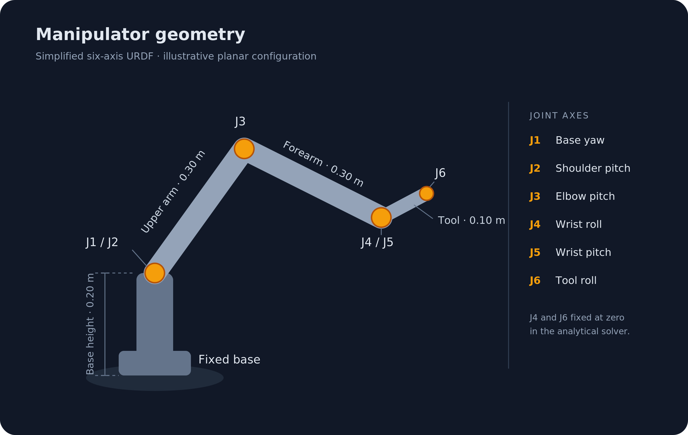

A **closed-form geometric inverse kinematics** project for a simplified **6-DoF serial manipulator**, benchmarked against **Orocos KDL** for Cartesian position accuracy and computational latency.

This repository packages a public, simplified **horizontal-link manipulator model** (`gemini.urdf`) and the corresponding analytical IK solver. It is **not** a hardware control stack, and it is **not** a general arbitrary-pose 6-DoF solver. The analytical formulation assumes a constrained end-effector orientation policy with joints **J4 = 0** and **J6 = 0**, while solving for base yaw, shoulder, elbow, and wrist pitch.

## Why this project?

GeoIK was built as a compact analytical alternative to iterative inverse kinematics for repeated Cartesian position queries. Instead of relying only on numerical optimisation, it uses geometric decomposition:

- **Base yaw** from the target's planar angle.
- **Wrist-center computation** by subtracting the tool offset.
- **Triangle geometry** and the **law of cosines** for shoulder and elbow.
- **Wrist pitch closure** to align with the radial end-effector pitch.
- Optional **PyKDL validation** using forward kinematics and KDL's LMA solver.

## Robot architecture



> The illustration above summarizes the simplified recovered robot topology used for the public repository.

## Solver pipeline

```mermaid
flowchart LR
    A[Target position p = (x, y, z)] --> B[Base yaw theta1 = atan2(y, x)]
    B --> C[Compute radial pitch and wrist center]
    C --> D[Reachability test]
    D --> E[Law of cosines for elbow]
    E --> F[Shoulder angle from triangle geometry]
    F --> G[Wrist pitch closure]
    G --> H[Joint vector [theta1, theta2, theta3, 0, theta5, 0]]
    H --> I[Optional FK / KDL verification]
```

## Simplified manipulator parameters

| Parameter | Value |
|---|---:|
| Upper arm `L1` | 0.30 m |
| Forearm `L2` | 0.30 m |
| Tool length `L_tool` | 0.10 m |
| Base height `h` | 0.20 m |
| Joint count | 6 revolute |
| Solved orientation policy | radial pitch, with J4 and J6 fixed |

## Repository structure

```text
.
├── gemini.urdf                     # Simplified horizontal-link URDF model
├── customIK.py                     # Recovered PyKDL comparison script
├── analytic_ik.py                  # Clean analytical solver module
├── benchmarks/
│   └── benchmark_analytic.py       # Lightweight self-consistency benchmark
├── tests/
│   └── test_ik.py                  # Unit tests for the clean solver
├── docs/
│   ├── robot_architecture.png      # README illustration
│   ├── KDL_VALIDATION.md           # Careful benchmark protocol / caveats
│   └── recorded_terminal_output.txt# Historical output recovered from notes
└── requirements.txt
```

## Quick start

Create an environment and install dependencies:

```bash
python -m venv .venv
source .venv/bin/activate   # Windows: .venv\Scripts\activate
pip install -r requirements.txt
```

Run the cleaned unit tests:

```bash
python -m unittest discover -s tests -v
```

Run the lightweight analytical benchmark:

```bash
python -m benchmarks.benchmark_analytic
```

Run the recovered KDL comparison script:

```bash
python customIK.py
```

## Historical recorded accuracy snapshot

The recovered notes include the following historical Cartesian position errors (millimetres) for three sample targets:

| Target point | KDL error (mm) | Analytical error (mm) |
|---|---:|---:|
| `(0.4, 0.0, 0.4)` | 0.0001 | 0.0016 |
| `(0.3, 0.1, 0.5)` | 0.0005 | 0.0016 |
| `(0.2, -0.1, 0.3)` | 0.0049 | 0.0009 |

These values are preserved as **historical recorded outputs** in `docs/recorded_terminal_output.txt`.

## Important benchmark caveat

The earlier timing comparison was useful, but not a perfectly matched-task benchmark. The analytical solver uses a radial pitch policy, while the old KDL call constructed a target frame from position alone. See [`docs/KDL_VALIDATION.md`](docs/KDL_VALIDATION.md) for the safer protocol before making strong comparative claims.

## Limitations

- Not a full arbitrary-pose 6-DoF IK solver.
- No collision checking, singularity avoidance, or hardware safety layer.
- No joint-limit handling beyond the URDF model.
- Historical KDL speedup claims should be re-validated under matched-task conditions.
- This repository is intended as a **kinematics demonstration and benchmark artifact**, not a production manipulator controller.

## Recommended public repo description

> Closed-form geometric inverse kinematics for a simplified 6-DoF manipulator, with a public URDF model, analytical solver, and Orocos KDL comparison for Cartesian accuracy and speed.
